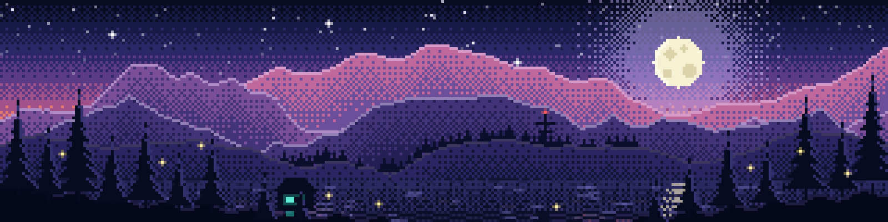
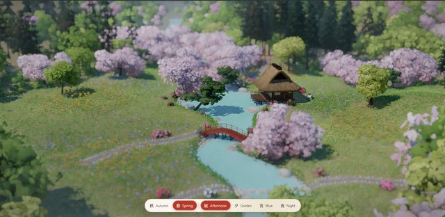
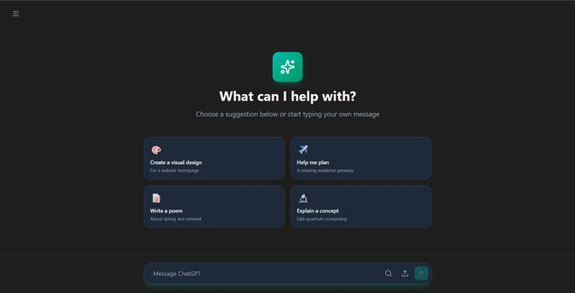
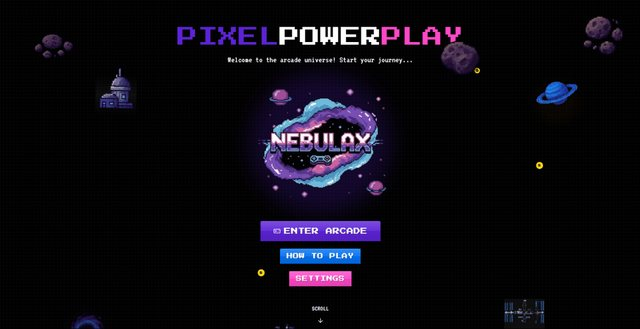
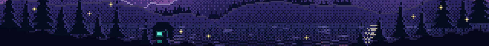

# Aniruddha Chaudhari

**Software engineer. I build full-stack products and AI agents.**
Builder, tinkerer. Always learning something new.

[Portfolio](https://aniruddhadev.in) · [LinkedIn](https://linkedin.com/in/aniruddha2704) · [LeetCode](https://leetcode.com/aniruddha-chaudhari) · [Kaggle](https://kaggle.com/aniruddhachaudhari27) · [Email](mailto:aniruddhachaudhari2704@gmail.com)

 

## What I do

<table>
<tr>
<td width="33%" valign="top">

**Product engineering**

Web and mobile products with real users, real state and the boring-but-important infrastructure around them.

React · Next.js · React Native · Node.js

</td>
<td width="33%" valign="top">

**AI systems**

Agents, memory, RAG and structured data pipelines: AI features that do more than wrap a chat endpoint.

Gemini · LangChain · Pinecone · Qdrant

</td>
<td width="33%" valign="top">

**Experiments**

Games, real-time systems, browser graphics, scraping and automation, and whatever rabbit hole looks interesting next.

Phaser · Three.js · WebSockets · Docker

</td>
</tr>
</table>

## Right now

- Working at [The Hobby Tribe](https://www.thehobbytribe.com), a startup that runs online hobby classes and skill programs.
- Building full-stack web and applied AI: Next.js front ends, FastAPI services, and retrieval agents on Gemini.
- Keeping [aniruddhadev.in](https://aniruddhadev.in) up to date. It's built with Next.js and has an isometric desk that follows your cursor.

## Selected work

> **VantageZero** · hardware buildability intelligence
> Tracks component stock, pricing, lead times and lifecycle data across suppliers, with validated, self-healing collectors.
> `Next.js` `Postgres` `Bright Data` · [Live ↗](https://vantagezero.vercel.app) · [Code ↗](https://github.com/aniruddha-chaudhari/vantagezero)

<table>
<tr>
<td width="33%" valign="top">

**Spring**

A Japanese garden diorama in the browser, with seasons, times of day, wildlife and falling petals.

`Three.js` `JavaScript`

[Live ↗](https://spring-blush.vercel.app) · [Code ↗](https://github.com/aniruddha-chaudhari/spring)

</td>
<td width="33%" valign="top">

**Gem AI**

Gemini chat with authentication, saved conversations and per-user long-term memory.

`Next.js` `Gemini` `Supermemory`

[Live ↗](https://gemai.aniruddhadev.in) · [Code ↗](https://github.com/aniruddha-chaudhari/gemai)

</td>
<td width="33%" valign="top">

**Nebulax**

A retro browser arcade built for a hackathon, with Phaser games and a pixel-art universe.

`Next.js` `Phaser` `Tailwind`

[Live ↗](https://nebulax-beige.vercel.app) · [Code ↗](https://github.com/aniruddha-chaudhari/nebulax)

</td>
</tr>
</table>

More at [aniruddhadev.in/projects](https://aniruddhadev.in/projects).

## Toolbox

| | |
|---|---|
| **Frontend** | TypeScript, React, Next.js, React Native, Tailwind CSS |
| **Backend** | Node.js, Express, FastAPI, REST APIs, real-time systems |
| **Data** | PostgreSQL, MongoDB, Supabase, Neon, Pinecone, Qdrant |
| **AI** | Gemini, LangChain, RAG, embeddings, agents, long-term memory |
| **Infra** | Docker, AWS EC2, GitHub Actions, Cloudflare |

## Say hi

I'm always up for a good project or a conversation about one. Email me at [aniruddhachaudhari2704@gmail.com](mailto:aniruddhachaudhari2704@gmail.com) or find me on [LinkedIn](https://linkedin.com/in/aniruddha2704).

